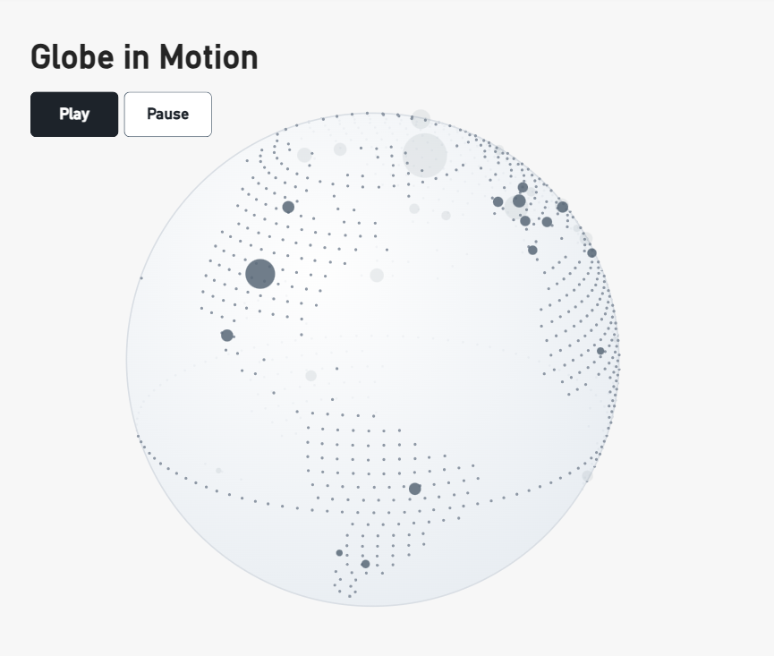

# Rotating globe for Power BI

An animated, dotted globe for Power BI, drawn by **one DAX measure** and shown in a standard **Image visual**. No custom visuals, no Azure Maps, no JavaScript.

<p align="center"></p>

- Bubbles are sized by any value, respond to slicers, and fade out as they pass behind the globe.
- A **Play / Pause** toggle is included, in line with [WCAG 2.2.2 Pause, Stop, Hide](https://www.w3.org/WAI/WCAG22/Understanding/pause-stop-hide).
- Power BI only loads a CSV and runs DAX. The Python scripts run beforehand, on your machine (see [Why Python?](#why-python)).

## Open the example

[`example/RotatingGlobe.pbip`](example) is a ready-made Power BI project with the globe, the Play / Pause toggle and a continent slicer. The sample data is stored inside the file, so there's nothing to set up. It needs a recent version of Power BI Desktop.

1. Download or clone this repo.
2. Open `example/RotatingGlobe.pbip` in Power BI Desktop.
3. Click **Refresh now** in the yellow banner. Power BI projects don't store data, so the first time you open one it needs a refresh. The globe's bubbles then appear and start turning.

## Quick start (no Python needed)

To add the globe to your own report instead, follow these steps. The sample data is already prepared, so you can try it straight away.

1. **Get data → Text/CSV** → load [`data/globe-data.csv`](data/globe-data.csv) and name the table **`Globe Data`**.
   Set `co2_mt` to *Decimal number*; keep `ring_y`, `px`, `py`, `op_values` and `op_keys` as *Text*.
2. **New measure** → paste the `Globe` measure from [`dax/Globe.dax`](dax/Globe.dax).
3. With the measure selected: **Measure tools → Data category → Image URL**.
4. **Insert → Image**. In the Format pane, under **Image**:
   - Image type: **Image URL**
   - Click **fx** → *Field value* → `Globe`
   - Scaling: **Fill**
5. Add a slicer on `continent` and watch the globe update.

### Add the Play / Pause toggle

Anything that moves automatically for more than 5 seconds next to other content should have a way to pause it (WCAG 2.2.2, Level A). From the same `Globe.dax` file:

1. **Modeling → New table** → paste `Globe motion`.
2. **New measure** → paste `Globe live`, and set its Data category to **Image URL**.
3. Point the Image visual at **`Globe live`** instead of `Globe`.
4. Add a **Button slicer** on `'Globe motion'[Motion]` and turn on **Single select**.

Power BI can't pause an animation inside an image, so on *Pause* the measure stretches every animation from 70 seconds to months. The globe sits still in practice and returns to its starting angle.

## Why Python?

Python is used to **prepare the files**, once, before anything goes into Power BI. It is not a Python visual or a Python data source, so the report works even where Python in Power BI is disabled, and nothing extra is needed in the Power BI service.

It's used for two jobs that are much better done once, up front, than inside the report:

1. **Drawing the land** ([`scripts/make_land_dots.py`](scripts/make_land_dots.py)). Each grey dot exists because a point on the globe fell inside a country outline from the Natural Earth world map. That means reading a map file and running thousands of point-in-polygon tests. Power BI isn't built for that, and the result never changes, so it's done once and saved as an SVG fragment ([`land/globe-static.txt`](land/globe-static.txt)).
2. **Placing the bubbles** ([`scripts/make_globe_data.py`](scripts/make_globe_data.py)). For each location, the script works out where it sits on the globe and the exact moments it disappears behind the globe and comes back, by checking every half-degree of a full turn. Doing this beforehand means:
   - the Power BI model stays light: just a few ready-made text columns, with no heavy calculation on every refresh
   - the DAX measure stays short and readable: it only assembles the SVG

You need Python only to put **your own locations** on the globe or to **change its look**. The scripts use Python 3 with no extra packages.

## Use your own data

1. Edit [`data/sample-countries.csv`](data/sample-countries.csv). You need `lat`, `lon` and a value per row. Countries, cities, offices: anything with a location works.
2. Run:

   ```bash
   python scripts/make_globe_data.py
   ```

   This rewrites `data/globe-data.csv`, `dax/Globe.dax` and `preview.svg`.
3. Open `preview.svg` in a browser to check the result, then refresh Power BI.

To size bubbles by a measure from your own model, add the geometry columns to your dimension table, replace `'Globe Data'[co2_mt]` in the measure with `CALCULATE ( [Your measure] )`, and use `MAXX` for `_max`.

### Change the look

Edit `STEP` (dot spacing), `TILT` (viewing angle), `DUR` (rotation time) or the colours at the top of `make_land_dots.py`. It downloads the Natural Earth outlines automatically. Then run both scripts:

```bash
python scripts/make_land_dots.py
python scripts/make_globe_data.py
```

If you change `TILT`, `DUR`, `CX`, `CY` or `R`, change them in **both** scripts.

## How it works

Seen from slightly above the equator, every line of latitude on a globe looks like a flat **ellipse**. So instead of 3D maths, the globe is a stack of latitude rings:

1. Each ring is a circle of points squashed vertically: `translate(450 ring_y) scale(1 sin(22°))`.
2. Everything on the ring spins with SVG's `<animateTransform type="rotate">`, one turn every 70 seconds.
3. Squashed, a dot circling its ring looks like it's travelling around the globe.

<p align="center"></p>

**Land** is drawn twice: a pale copy clipped to the far side, then a translucent sphere, then a darker copy clipped to the near side.

**Bubbles** are placed using the columns that `make_globe_data.py` adds:

| Column | Meaning |
|---|---|
| `ring_y` | Vertical position of the location's latitude ellipse |
| `px`, `py` | Position on the ring at the start of the rotation |
| `op_values` | Opacity steps: `0.88` in front, `0.10` behind |
| `op_keys` | When each step starts, as a fraction of one turn |

Because the speed is fixed, the moments a bubble goes behind the globe and comes back can be worked out in advance. An SVG `<animate>` then switches its opacity at exactly those times.

The `Globe` measure loops over the rows with `CONCATENATEX`, builds one bubble per row (diameter based on the square root of the value, so area reflects the value), wraps it all in an `<svg>` and returns it as a `data:image/svg+xml` URI.

## Files

```
data/sample-countries.csv   32 countries: name, continent, lat/lon, 2023 fossil CO₂ (Mt)
data/globe-data.csv         the same rows + geometry columns → load this into Power BI
dax/Globe.dax               Globe measure, Globe motion table, Globe live measure
example/RotatingGlobe.pbip  ready-made Power BI project, sample data built in
land/globe-static.txt       land dots + sphere (already inside the Globe measure)
preview.svg                 what the Globe measure draws for the sample data
images/                     screenshots for this README
scripts/make_globe_data.py  adds the geometry columns, writes Globe.dax and preview.svg
scripts/make_land_dots.py   redraws the land dots
```

## Notes

- The `Globe` measure is about 35,000 characters, mostly land dots.
- Each row is a single point, which is approximate for very large countries.
- Tested in Power BI Desktop. Exported PDFs and PowerPoint files show a still image.

## Credits

- Emissions data: Global Carbon Project, via [Our World in Data](https://github.com/owid/co2-data) (CC BY 4.0).
- Land outlines: [Natural Earth](https://www.naturalearthdata.com/) 1:110m (public domain), via [world-atlas](https://github.com/topojson/world-atlas).

## License

Code and DAX: [MIT](LICENSE). Data files keep their original licences (see Credits).
